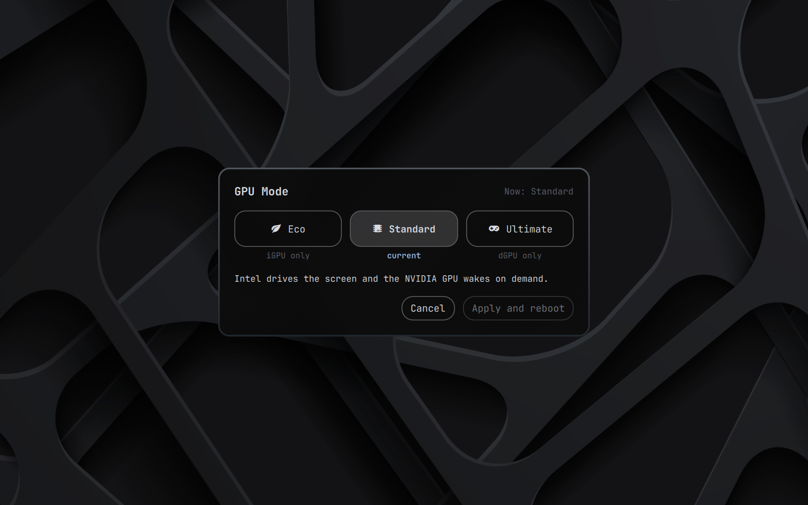

# GPU Mode for Omarchy



Switch an ASUS laptop between three GPU modes from the Omarchy menu, G-Helper style. Every switch is followed immediately by a reboot, and takes exactly one.

The plugin is a small window (`Trigger > Hardware > GPU Mode`) on top of `supergfxd`. It is a single-purpose tool: no fan, lighting, power-limit or charge-limit control.

## Modes

| Mode | supergfxd mode | MUX | What it does |
| --- | --- | --- | --- |
| Eco | `Integrated` | Optimus | The dGPU is disabled in firmware. Best battery life. Games and CUDA cannot see the dGPU. |
| Standard | `Hybrid` | Optimus | The iGPU drives the screen and the dGPU wakes on demand. |
| Ultimate | `AsusMuxDgpu` | dGPU | The dGPU drives the screen directly. Best performance, highest power draw. |

Switching Ultimate to Eco also takes one reboot.

### How Eco works

Eco powers the dGPU off in firmware, as G-Helper does. The plugin sets `"hotplug_type": "Asus"` in `/etc/supergfxd.conf`. With it, `supergfxd` sets `dgpu_disable=1` when it boots in `Integrated`, and its wake handler sets it again after each resume. The firmware then keeps the GPU off the PCI bus across suspend (verified on the hardware listed below). Leaving Eco, the helper writes `dgpu_disable=0` before the MUX: the kernel refuses MUX = dGPU while the dGPU is disabled, and `supergfxd` would otherwise boot back into `Integrated`.

The helper never writes `dgpu_disable=1` while any NVIDIA PCI function is present. If you revert to Eco before the reboot and the GPU is still absent, it writes 1 back; otherwise the window keeps asking for a reboot. Reboot right after a switch, before suspending: on resume `supergfxd` re-disables the dGPU while it still runs Eco. If a switch still lands in Eco, the window says so; apply the mode again.

Earlier versions used a sleep hook that switched to Vfio and back to Integrated after resume. On resume the firmware brings the GPU back and the desktop opens it within seconds, so the hook could not power it off safely. The hook is gone; the helper and the root install remove its old file.

## Tested on

- ASUS ROG Zephyrus G16 GU603ZV (Intel iGPU + RTX 4060 Laptop), Omarchy 4.0.6, kernel 7.2.8, supergfxctl 5.2.7, nvidia-open 615.78. All six transitions, each with one reboot, and suspend in Eco: see [docs/notes/2026-10-28-hardware-test.md](docs/notes/2026-10-28-hardware-test.md).

Other ASUS models with a MUX should behave the same through `supergfxd`, but are untested. The plugin changes firmware GPU settings; read the recovery section before the first switch.

## Requirements

- An ASUS laptop with a MUX switch, `supergfxd` running, and your user in `wheel`.
- Omarchy 4.0.6 or newer.

## Install

From the Omarchy plugin catalog:

```
omarchy plugin add https://github.com/devSviat/omarchy-gpu-mode --enable
~/.config/omarchy/plugins/sviat.gpu-mode/install.sh
sudo ~/.config/omarchy/plugins/sviat.gpu-mode/install-root.sh
```

Or from a checkout (`install.sh` links the checkout as the plugin):

```
git clone https://github.com/devSviat/omarchy-gpu-mode && cd omarchy-gpu-mode
./install.sh
sudo ./install-root.sh
```

`install.sh` enables the plugin and adds the menu row. `install-root.sh` installs the privileged helper and the polkit action and normalises the config. The Eco drop-in is not installed here; a switch to Eco installs it.

Reboot to finish (Eco uses the new firmware power-off from the next boot).

The checkout is writable by your user, so anything running as you can change it. Before each `sudo` run, review what changed since you last checked, for example with `git -C <repo> log` and `git -C <repo> diff`.

The root step never changes the GPU mode. It sets `"hotplug_type": "Asus"` in `/etc/supergfxd.conf`, normalises a stale `mode` so that it matches the MUX, and removes the old GPU Mode sleep hook. In Eco it also removes Omarchy's `force-igpu` sleep hook, which conflicts with the firmware-disabled dGPU. If that normalisation fails, the helper and polkit action stay installed; fix the reported problem and run the root step again, or remove it with `--remove`.

The menu row replaces the stock "Hybrid GPU" row. The installer edits `~/.config/omarchy/extensions/omarchy-menu.jsonc` between `// >>> sviat.gpu-mode` and `// <<< sviat.gpu-mode` markers, and writes a timestamped `.bak` next to the file before each change. A `trigger.hardware.hybrid-gpu` entry of your own placed later in that file overrides the GPU Mode row.

## Changes made in the BIOS

If you flip the MUX in the BIOS, `supergfxd` adapts at boot but does not rewrite its config. The window shows the mode that is actually running and raises no "waiting for a reboot" banner; that banner appears only after a switch made from the window.

## External monitors

On many ASUS laptops the HDMI and USB-C DisplayPort outputs are wired to the dGPU. In Eco they do not work. The window warns about this only when a monitor is currently connected to such a port.

## Recovery

From a TTY (Ctrl+Alt+F3), then reboot:

- Stuck in Ultimate: set the MUX back to Optimus, or set it to Optimus/Dynamic in the BIOS.

  ```
  echo 1 | sudo tee /sys/class/firmware-attributes/asus-armoury/attributes/gpu_mux_mode/current_value
  ```

- Stuck in Eco: re-enable the dGPU, and/or set `"hotplug_type": "None"` in `/etc/supergfxd.conf` (with `None`, `supergfxd` clears `dgpu_disable` at boot and starts in Hybrid).

  ```
  echo 0 | sudo tee /sys/class/firmware-attributes/asus-armoury/attributes/dgpu_disable/current_value
  ```

Do not use `supergfxd.mode=` on the kernel command line for this. `supergfxd` writes that mode into its config permanently, with `"hotplug_type": "Asus"` and the dGPU disabled it still boots Integrated, and with the MUX on dGPU any mode becomes `AsusMuxDgpu`.

## Uninstall

1. Switch to Standard or Ultimate. Eco keeps the dGPU disabled in firmware, so both remove commands refuse to run while the config is in Eco.
2. Reset `hotplug_type` to `"None"` and remove the root files, which are the helper, polkit action and drop-in, plus the old sleep hook if present. The stock `omarchy-toggle-hybrid-gpu` cannot leave Eco while `hotplug_type` is `"Asus"`, so the reset runs first:

   ```
   sudo ./install-root.sh --remove
   ```

3. Remove the menu row (the stock "Hybrid GPU" row returns), disable the plugin and remove the link:

   ```
   ./install.sh --remove
   ```

   For a catalog install, run the same script from `~/.config/omarchy/plugins/sviat.gpu-mode/` and then `omarchy plugin remove sviat.gpu-mode`.

## Development

To test suspend in Eco, use `sudo rtcwake -m no -s 60 && systemctl suspend`. `rtcwake -m mem` bypasses logind, so `supergfxd`'s wake handler does not run.

```
python3 -I tests/test_state.py && python3 -I tests/test_apply.py && python3 -I tests/test_menu.py && node --test tests/ && bash tests/test_root_install.sh && bash tests/test_install.sh
```

The plugin is not audited by third parties and makes no claims beyond its own tests.

## License

MIT
